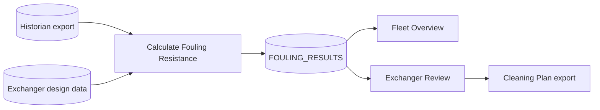

# Content of each part

Outlines for the pages and documents a packaged analysis carries. Take every fact from the App
Brief, the Logic Spec or the built DXP; add no claim they do not support.

## Cover page

The page the analysis opens on. Starting point: `assets/cover-page.html`.

| Element | Content |
|---|---|
| Title | The app name, exactly as everywhere else |
| Audience line | Who it is for, in one line ("For process engineers and maintenance planners") |
| Problem | The first two sentences of the App Brief's business problem |
| What it does | One sentence on what the analysis does about the problem |
| Start here | The first page and the first step |
| Your own data | Where to load it (Data Staging page) and where the setup guide is |
| Requirements | Spotfire version, and Python packages beyond the bundled ones if any |

No version number, release history or author names on the cover; they go in the release notes.

## Method page

Explains the calculations; does not tune them. Starting point: `assets/method-page.html`.

- One short paragraph: what the analysis computes and from which data.
- One block per Logic Spec entry behind a KPI, in the order the KPIs appear:
  - name and what it tells the user (one sentence);
  - the formula in plain text (`Rf = 1/U_actual - 1/U_clean`), simplified where the full form
    adds nothing for the user;
  - inputs with units and where each comes from (column, setting);
  - assumptions, valid range and known limits;
  - the reference (standard, correlation, textbook) when the Logic Spec gives one.
- For a model (statistical or machine learning): what it was trained or calibrated on, what its
  output means, when not to trust it. No training metrics or tuning controls.

## Guide page

A reference for users who want to know what is where.

| Section | Content |
|---|---|
| Pages | Each page: purpose in one sentence, how to use it in one to three steps |
| Data | Each table users see: what one row is, the key columns with units |
| Calculations | Each data function: what it does, its inputs and outputs, when it runs (on open, on change, on a button) |
| Controls and buttons | What each one changes |
| Requirements | Spotfire version, Python packages, data the user must supply |

A small app may merge the Guide into the Method page.

## Data Staging page

Only when users bring their own data.

- How to load the data (replace the data table, or a file picker the app provides).
- A mapping control or table: each required and optional column of the data model, and the user's
  column mapped to it.
- A validation readout: columns found, mapped, defaulted (with the default used) and missing;
  type mismatches, empty columns, values out of range.
- A clear way back to the demo data.

## Data Generation page

Only when the app generates data. Last page. The header says, in one line, that the page is for
advanced users and rebuilds the demo data. It holds the Build or Simulate buttons, every generator
and calibration setting, and a small readout that checks the generated dataset.

## Release notes (`RELEASE-NOTES.md`)

```markdown
# <App name> <version>

Released: <date>
Tested on: Spotfire Analyst <version> (and Web Player <version>, if tested)

## What it does
<The business problem and what the analysis does, two sentences.>

## Changes in this version
- <change>

## In scope / out of scope
- In: <items>
- Out: <items from the App Brief's Out of scope>

## Known issues
- <issue and workaround>

## Third-party components
| Component | Version | License |
|---|---|---|

## Approvals and checklist exceptions
| Item | Status or reason |
|---|---|
```

## Setup and data guide (`setup-guide.md`)

1. Requirements: Spotfire version, Python packages, permissions (trusting scripts).
2. Open the analysis: library location, the trust prompt and who may accept it.
3. Data model: one table per input table with columns, unit, type, required or optional, default
   when missing.
4. Load your own data: steps on the Data Staging page, how mapping works, what the validation
   readout means.
5. When data is missing or wrong: what the app does for each missing optional column; what stops a
   run.
6. Refresh: when calculations rerun and how long they take.

## Article or overview

1. The business problem: who has it, what it costs, how it is handled today (from the App Brief).
2. What the analysis does about it, in two or three sentences.
3. A walkthrough of the pages with one large screenshot each.
4. The data a user needs and how to bring their own.
5. How the numbers are calculated, summarised from the Method page.
6. Requirements and the download link.

Write it in plain sentences for the people who have the problem. Start with the problem; mention
Spotfire features only where the reader needs them to use the app.

## Architecture diagram

One diagram from data sources to actions. Mermaid example:



## Screenshots

- One per page from the released build, at one window size, with the page as it opens.
- One more per page that shows an interaction (a marking that updates the page).
- Capture the Spotfire window only, so nothing else on the screen appears; redact user names,
  paths and server addresses. The `testing-dxps-through-the-ui` skill captures and redacts.
